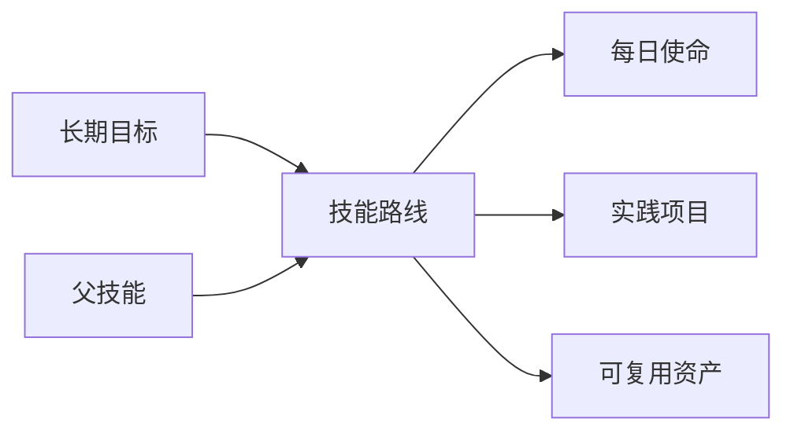

# Phase 4.3：技能树简化版

技能树是用户自行定义的成长路线图。导航用“技能树”替换“成长记忆”，原有个人档案、目标与决策数据继续保留。状态只表示用户设定的学习阶段，不推断能力、不自动升级、不计算经验值。

## 本地启用与数据保护

在本地测试数据库设置 `GENESIS_ENABLE_SKILL_TREE=1` 后启动既有 Express 服务。使命管理仍由 `GENESIS_ENABLE_QUEST_BUILDER=1` 独立启用，技能树不会从旧计划或存档读取使命。

首次启用先用 SQLite 在线备份保存到数据库旁的 `backups/genesis-before-skills-*.sqlite`，成功后执行 `migrations/local/0006_genesis_skills.sql`。备份失败终止启动升级。重复启动及重复执行 SQL 不重复创建表或记录。不生成初始技能，不改写任何旧业务表。

本阶段只启用本地测试环境；未增加 D1 迁移，未远程部署。云端静态页面保留入口，但未启用时显示空状态，不发起技能写入。数据库、备份和真实密钥不能提交 Git。

## 最小模型

`genesis_skills`：`id`、`name`、`description`、`category`、`parent_id`、`status`、`revision`、`source_type`、`visibility`、`created_at`、`updated_at`。

名称必填，最多 160 字符；描述最多 2000；分类最多 60。默认 `source_type=manual_skill`、`visibility=private`。`revision` 用于拒绝过期编辑。父节点必须存在，不能指向自己，也不能形成任何层级循环。默认状态为尚未开始。

| 状态 | 中文 |
| --- | --- |
| not_started | 尚未开始 |
| learning | 学习中 |
| practicing | 实践中 |
| mastered | 已掌握 |

`genesis_skill_links`：`id`、`skill_id`、`target_type`、`target_id`、`created_at`。

类型为 `goal`、`quest`、`project`、`asset`，唯一约束为 `(skill_id,target_type,target_id)`。保存关联前检查目标存在，项目使用已有合并别名解析。新关联不能指向已删除使命。解除只删除关联，不删除原记录；关联内容支持只读查看。

这是一组可选关联，不自动生成 Goal → Quest → Project → Asset 的业务记录。没有关联时显示空状态。

## 接口

| 方法 | 路径 | 用途 |
| --- | --- | --- |
| GET | `/api/genesis/skills` | 节点、关联、可选目标/使命/项目/资产 |
| POST | `/api/genesis/skills` | 创建用户自定义技能 |
| PATCH | `/api/genesis/skills/:id` | 编辑名称、描述、分类、父节点、状态 |
| POST | `/api/genesis/skills/:id/links` | 添加已有记录关联 |
| DELETE | `/api/genesis/skills/:id/links/:linkId` | 解除关联 |
| GET | `/api/genesis/skills/reference/:type/:id` | 只读查看关联内容 |

接口沿用浏览器会话认证与同源写入保护。所有写入需要 `Idempotency-Key`；编辑和关联还需要当前技能的 `revision`。同一请求重放返回 `deduplicated: true`，不同内容复用标识返回 409。重复关联也不生成第二条记录。技能状态不会因关联数量或使命完成改变。

## 页面组件

`genesis-skills.js` 负责创建/编辑弹窗、关联选择、详情与保存反馈；`genesis-skill-model.mjs` 负责只读层级组织与后代过滤；`12-genesis-skills.css` 复用暖金光晕和金属面板。

树采用嵌套 HTML，父节点支持展开和折叠，节点按钮打开详情。移动端收紧缩进，较深层级保留结构但停止叠加缩进，名称换行。按钮支持键盘操作，弹窗具备标签、焦点和错误反馈。分类与手动阶段不显示等级、锁定或进度百分比。

页面加载、切换和刷新只读取。写入仅来自用户点击保存或解除关联。断网不自动重试、不显示成功；同一未确认请求保留标识，重新尝试可由服务端去重。

## 验证

`npm run test:genesis-skills` 使用真实 Express、临时 SQLite 和 HTTP 请求，验证创建、编辑、重设父节点、循环检查、四类关联与解除、并发版本、幂等、认证、跨站、参数校验、100 次读取、重启保持、重复迁移与备份失败保护，并对比旧表结构及内容。

交付前另运行 `npm run check:syntax`、`npm test`、`npm run genesis:cloud:build`。静态构建不代表部署。浏览器测试使用独立副本创建示例节点，正式本地预览库只增加空表。

### 本次验收记录（2026-10-13）

- 语法检查、全部 28 个测试脚本、本地静态构建通过。
- 隔离浏览器测试创建四层节点，验证编辑、调整父节点、展开/折叠、四类关联、查看资产、解除目标关联和刷新保持。
- 390 像素手机宽度下，树和详情没有横向溢出。
- 停止隔离服务后保存显示明确网络失败，输入保留，数据库未变化；恢复服务后用户主动重试保存成功。
- 本地预览数据库升级前备份完整，所有原表结构与内容保持一致；两张新表均为空，不向个人资料自动写入测试示例。
- 未执行远程 D1 操作或部署，未引入 LLM API。
